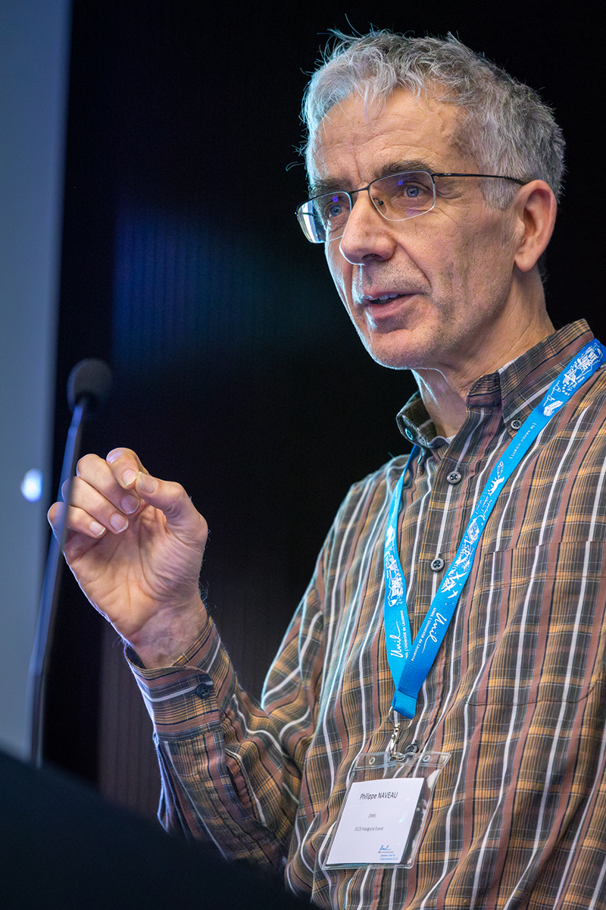
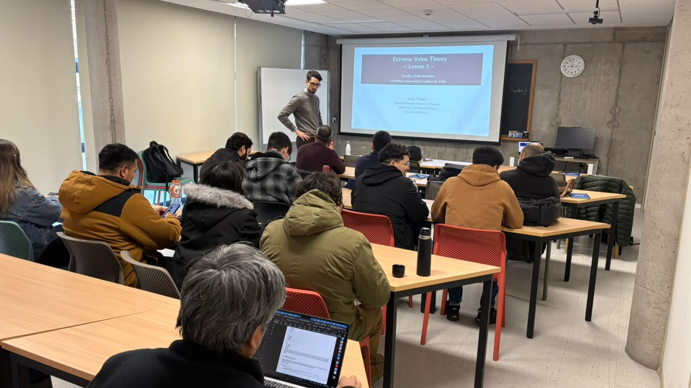
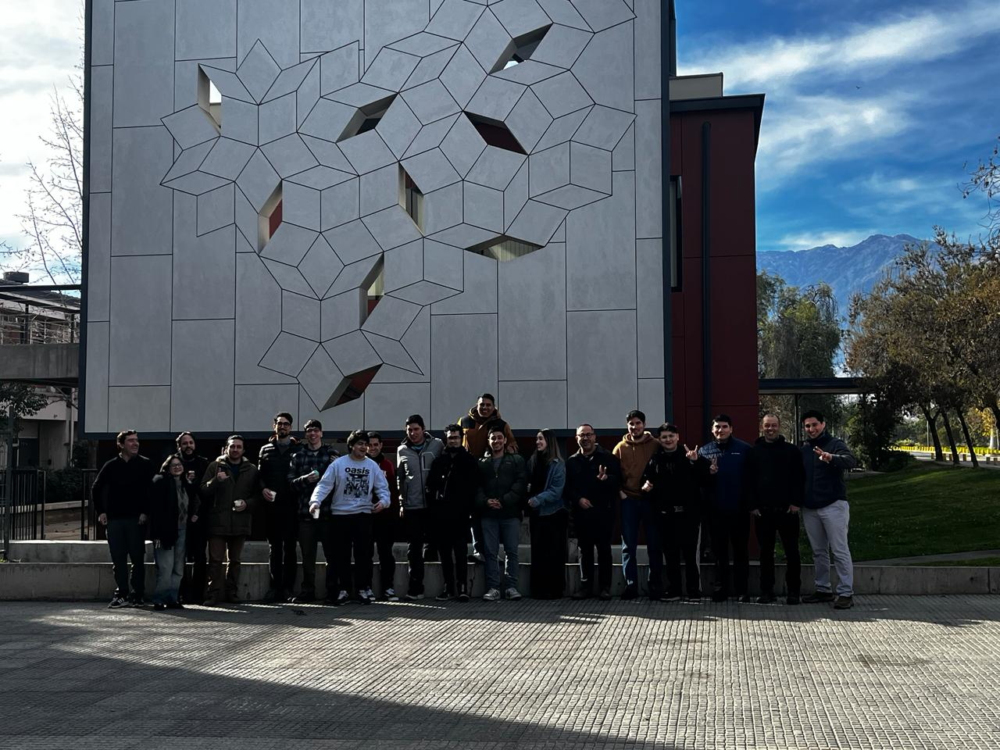

# Public Lectures & Visits

## Philippe Naveau

Philippe Naveau will give a public lecture and visit the University of Edinburgh as part of the GLE2N programme.

More details are available from the [GLE2N visitors page](https://glen-scotland.github.io/glen/visitors.html).

<figure class="school-venue-photo visit-photo">
  
</figure>

### Intensive PhD Course on Extreme Value Theory — Pontificia Universidad Católica de Chile

**6–10 July 2026 | Santiago, Chile**

Luca Trapin (University of Bologna) delivered a five-day intensive PhD-level course on **Extreme Value Theory** at the Faculty of Mathematics of the Pontificia Universidad Católica de Chile (PUC).

The 20-hour course covered the theoretical and methodological foundations of extreme value statistics, including classical extreme value models, peaks-over-threshold methods, extremes of dependent and non-stationary sequences, and multivariate extremes.

The visit also provided an opportunity to strengthen scientific collaboration between the University of Bologna and PUC within the **GAMEX network**, supporting ongoing research exchanges and the development of future joint training and mobility initiatives.

  

  

